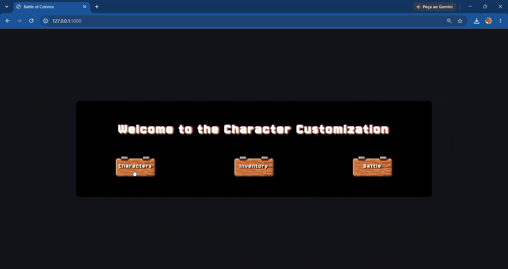

# Criador de Personagens (Flask)

Aplicação web em Python/Flask para criar, listar, editar e excluir personagens, feita para **praticar CRUD, rotas e validação no back-end** em uma estrutura em camadas. O projeto faz parte de uma ideia maior de jogo ("Battle of Colonos"), da qual hoje só a tela de personagens está implementada.

## Funcionalidades

- **Criar** um personagem com nome, cor do cabelo e roupa, salvo em banco de dados SQLite.
- **Listar** todos os personagens na mesma página do formulário, em cartões.
- **Editar** um personagem: o formulário é preenchido com os dados atuais e o botão passa a salvar as alterações.
- **Excluir** um personagem pelo botão do cartão.
- **Validar no back-end** antes de gravar: nome obrigatório, e cabelo e roupa precisam ser um dos valores permitidos. Os erros aparecem ao lado do campo correspondente.
- **Preservar o que foi digitado** quando a criação falha, usando sessão e o padrão Post/Redirect/Get.

| Atributo | Tipo | Valores aceitos |
|---|---|---|
| Nome | texto | qualquer texto não vazio |
| Cabelo | seleção | `blue`, `red` |
| Roupa | seleção | `t-shirt`, `pants` |

## Rotas

| Método | Rota | O que faz |
|---|---|---|
| GET | `/` | Página inicial |
| GET | `/customization` | Lista os personagens e mostra o formulário de criação |
| POST | `/customization/create` | Valida e cria um personagem |
| GET | `/customization/edit/<id>` | Mostra o formulário de edição preenchido |
| POST | `/customization/update/<id>` | Valida e atualiza o personagem |
| POST | `/customization/delete/<id>` | Exclui o personagem |

## Arquitetura

```
├── app.py                      # cria a aplicação Flask e registra o blueprint
├── database.py                 # engine e sessão do SQLAlchemy (SQLite)
├── models/
│   └── Character.py            # entidade Character (id, name, hair, clothes)
├── routes/
│   └── character.py            # rotas HTTP do blueprint /customization
├── services/
│   └── character_service.py    # regras de negócio, validação e acesso ao banco
├── utils/
│   └── Results.py              # objeto de resultado (success, data, errors)
├── templates/                  # páginas Jinja2
├── static/                     # CSS e imagens
├── requirements.txt
└── .env.example
```

O fluxo segue três camadas: a **rota** recebe a requisição e chama o **service**, que valida os dados, acessa o banco pelo **model** e devolve um objeto `Results` com o sucesso, os dados e os erros. A rota decide então entre renderizar a página ou redirecionar.

## Tecnologias

| Função | Ferramenta |
|---|---|
| Linguagem | Python |
| Framework web | Flask 3.1 |
| ORM e banco | SQLAlchemy 2.0 com SQLite |
| Templates | Jinja2, HTML e CSS |
| Variáveis de ambiente | python-dotenv |

## Como executar

### Pré-requisitos

- Python 3.10 ou superior

### Passos

```bash
# 1. Clone o repositório
git clone https://github.com/NicolasPPeixoto/character-creator-flask.git
cd character-creator-flask

# 2. Crie e ative um ambiente virtual
python -m venv venv
venv\Scripts\activate          # Windows
# source venv/bin/activate     # Linux / macOS

# 3. Instale as dependências
pip install -r requirements.txt

# 4. Configure a chave secreta
copy .env.example .env         # Linux / macOS: cp .env.example .env
# edite o .env e defina SECRET_KEY (sugestão para gerar uma chave:
# python -c "import secrets; print(secrets.token_hex(32))")

# 5. Execute
python app.py
```

Acesse `http://127.0.0.1:5000` no navegador. O banco é um arquivo local (`database.db`) e não vai para o repositório.

> Sem `SECRET_KEY`, a aplicação não inicia e exibe uma mensagem explicando como configurar.

## Estado atual e próximos passos



Hoje o personagem aparece na lista apenas com seus **atributos em texto**. O painel "Preview" da tela já existe, mas ainda está vazio, e os botões "Inventory" e "Battle" da página inicial ainda não têm função.

- [ ] Preview visual do personagem de acordo com cabelo e roupa escolhidos
- [ ] Mais atributos e opções de personalização
- [ ] Testes automatizados
- [ ] Inventário e batalha

## Autor

Nícolas Pietro Peixoto: [GitHub](https://github.com/NicolasPPeixoto) · [LinkedIn](https://www.linkedin.com/in/nicolas-peixoto-/)
